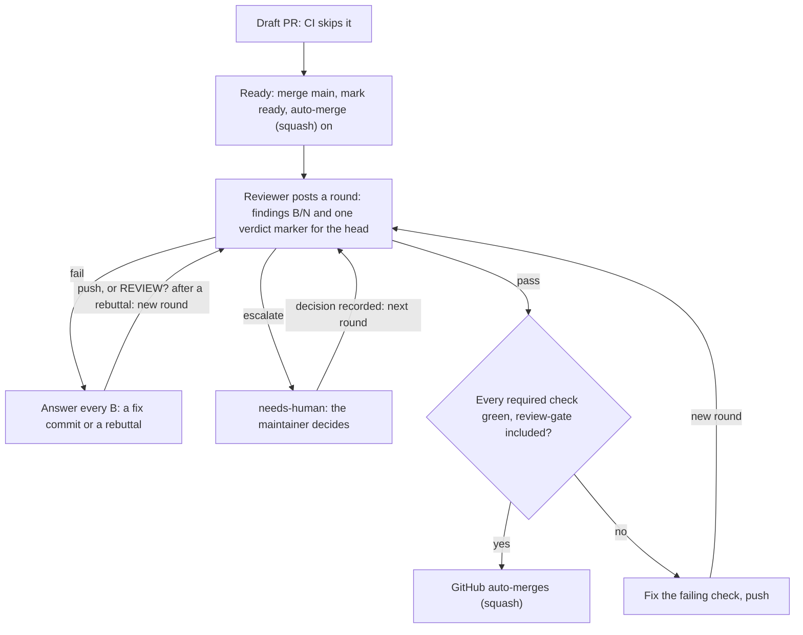

<!-- @doc
id = "CLAUDE"
title = "Agent instructions"
kind = "normative"
status = "active"
review_every = "90d"
-->

# CLAUDE.md

> The builder's entry point: how to find the rules that govern your change, your docs duty,
> and the PR loop from draft to auto-merge.

It does **not** restate rules. It says where they are and how to find the ones that apply
to your change. Your role's brief is in [docs/agents/](docs/agents/README.md).

## First: which repo is this?
<!-- @section
depends_on = ["AGENT-INTAKE#outputs"]
-->

Compare `[template].source` in [`repo.toml`](repo.toml) with this repo's own `<owner>/<repo>`,
from `git remote get-url origin`.

- **They are equal: this is the template** (jeffmhopkins/template<!--fact:template-source-->).
  You are improving the swarm itself: the tool, the checks, the rules, the runbooks and the
  briefs. Never run intake, and never fill a `<from intake>` placeholder; each project fills
  them.
- **They differ: this is a project made from the template.** While `docs/PRODUCT.md` has
  `status = "draft"`, intake hasn't run. Until its design PR merges, only the intake agent
  edits the product docs ([intake brief](docs/agents/intake.md#outputs)). Template changes
  reach the project through the [template-upgrade runbook](docs/runbooks/template-upgrade.md).

## Before you change anything
<!-- @section
-->

1. Read [docs/DOCS.md](docs/DOCS.md) once. It explains how docs, rules and verification work.
2. For every file you will touch, run `scripts/repo docs for <path>`. It lists the rules,
   doc sections and ADRs that govern that file. Read them.
3. If your change contradicts an accepted ADR, stop and propose a new ADR that supersedes
   it ([R-ARCH-001](docs/RULES.md#R-ARCH-001)).

## Your documentation duty
<!-- @section
depends_on = ["DOCS#ledger", "DOCS#notes", "DOCS#merge"]
-->

- `scripts/repo docs check` lists the sections your change made stale. Re-read each one
  against your diff. If it's wrong, **edit it**. Either way, once it holds, record it:
  `scripts/repo docs verify <DOC#anchor> --by agent:<name> --note "<what you checked>"`.
- Never type dates, revisions or history into docs; git provides them. Never edit
  `@generated` blocks; run `scripts/repo docs generate` (for example after changing an
  ADR's status).
- Delivering a roadmap item → end the PR body with `Completes: <id>`, or `Part-of: <id>`
  for one part of a larger item. Progress is derived from these lines
  ([DOCS › Progress](docs/DOCS.md#progress)); never edit `docs/progress.toml` for it.
- New external URL → register it in `docs/external.toml`. Repeated value →
  `docs/facts.toml`.
- New package root → add its `Docs:` back-reference line
  ([DOCS › Back-references](docs/DOCS.md#backrefs)).
- Never edit `docs/verified.toml` by hand. Only `docs verify` writes it, and
  `docs merge-main` keeps entries that still match.
- To bring `main` into your branch, run `scripts/repo docs merge-main`. It resolves
  conflicts in the ledger, inside `@generated` blocks and in the stack's lockfiles, and
  leaves every other conflict to you. Then re-read and verify each section it lists as
  stale, each with its own note: what the earlier note it prints said about your change,
  plus what the merge changed
  ([DOCS › Notes](docs/DOCS.md#notes)). A PR into a wave branch merges its wave instead:
  `scripts/repo docs merge-main --from wave/<name>`
  ([waves runbook](docs/runbooks/waves.md)).

## The PR loop (you are a builder)
<!-- @section
depends_on = ["REVIEW#output", "REVIEW#rounds", "RULES#R-GOV-005", "RULES#R-GOV-006"]
-->

1. Open a **draft** PR early. The title is a Conventional Commit
   ([R-GIT-002](docs/RULES.md#R-GIT-002)) and the body answers
   `.github/pull_request_template.md`. CI skips drafts.
   Every commit you push ends with a `Claude-Session: <your session URL>` trailer, and so
   does the PR body: the squash commit takes the body as its message, and `review-gate`
   fails a commit without the trailer ([R-GIT-005](docs/RULES.md#R-GIT-005)).
2. When it is ready: merge `main` (never rebase), mark it ready, and turn on **auto-merge
   (squash)**, with the GitHub MCP tool `enable_pr_auto_merge` (`mergeMethod: SQUASH`) or
   `gh pr merge <n> --auto --squash`. It merges by itself once every required check,
   `review-gate` included, is green. If enabling fails, say so in the PR. A PR that changes
   a serial lane keeps auto-merge off until it holds the slot
   ([serial-lanes runbook](docs/runbooks/serial-lanes.md)).
3. A reviewer agent comments findings `B<n>` (blocking) and `N<n>` (non-blocking), and ends
   each round with a verdict marker. **Never post a review marker yourself, and never merge
   by hand.**
4. Answer every blocking finding: push a fix and reply naming the commit, or reply with a
   concrete rebuttal ([R-GOV-004](docs/RULES.md#R-GOV-004)). Each push starts a new review
   round. So does a rebuttal without a push, once you send the reviewer `REVIEW?` for the
   same head.
5. Non-blocking findings: fix them if cheap, or say they're deferred. Pre-existing problems
   become issues.
6. A `needs-human` label means the maintainer decides. Stop arguing that point.
7. **Writing an ADR:** start from [docs/adr/TEMPLATE.md](docs/adr/TEMPLATE.md) and set its
   `tier` per [R-GOV-005](docs/RULES.md#R-GOV-005) and
   [ADR-0003](docs/adr/0003-decision-tiers.md). A `maintainer` ADR opens as `proposed` with
   `needs-human` and waits for the maintainer's `/accept` or `/reject`. You may post a
   decision **only** to relay the maintainer's own words that name the ADR, in the proxy
   format of ADR-0003. **Never post a decision they didn't give.** Everything else is
   `agent` tier: decide it yourself and land it as `accepted` after review.
8. Anything else that needs the maintainer follows the approval contract
   ([R-GOV-006](docs/RULES.md#R-GOV-006)).

## Things you never do
<!-- @section
-->

> [!CAUTION]
> Never merge by hand, post a review verdict, or change branch protection or repository
> settings. A PR lands only through GitHub auto-merge, once `review-gate` and every other
> required check is green.

- Apply `review-override`, ever, or `governance-approved` on a PR that changes a
  maintainer-only path. Only the maintainer applies those. Agents post under the
  maintainer's login, so the checks can't tell the difference: this rule is what does
  ([R-GOV-002](docs/RULES.md#R-GOV-002)).
- Apply `governance-approved` without writing the "Governance change" section in the PR
  description, or before examining what the check flagged. A push removes the label; apply
  it again only after examining the new head. Every use goes to the maintainer's weekly
  audit.
- Change branch protection or repository settings, merge by hand, or post a review verdict.
- Weaken a check silently. A lint suppression, narrowed `covers` or `applies_to`, or an edit
  to lint, licence or CI config is always a declared governance change
  ([R-GOV-001](docs/RULES.md#R-GOV-001)).
- Verify a section you did not re-read.
- Claim a test ran when it didn't. List what wasn't run
  ([R-TEST-003](docs/RULES.md#R-TEST-003)).

## Commands
<!-- @section
depends_on = ["DOCS#tool"]
-->

The stack's own commands (format, lint, test, dependency check) are in its pack under
`stacks/`; `scripts/repo stack run <job>` runs one. The repo tool, invoked as
`scripts/repo …`:

| Command | Use |
|---|---|
| `docs check` | what is stale or broken, and why |
| `docs for <path>` | the rules, sections and ADRs that govern a file |
| `docs verify <DOC#anchor> --by … --note "…"` | restamp a section after a re-read |
| `docs generate` | rewrite `@generated` blocks |
| `docs merge-main [--from wave/<name>]` | merge main or a wave, resolving ledger, generated and lockfile conflicts |
| `docs log <DOC[#anchor]>` | history, from git |
| `governance --base origin/main` | list your PR's governance changes |
| `pr-title "<title>"` | check a Conventional Commit title |
| `progress` | derived roadmap status |
