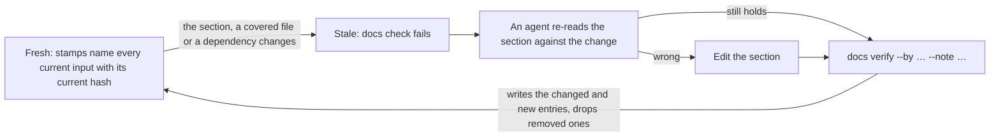

<!-- @doc
id = "DOCS"
title = "Documentation system"
kind = "normative"
status = "active"
review_every = "90d"
-->

# Documentation system

> Docs are a graph of anchored sections, each bound by hashes to the code and rules it
> describes. Change an input and the section is stale until an agent re-reads it.

How documentation stays accurate as the code and the outside world change. The binding
rules are `R-DOC-*` in [RULES](RULES.md#documentation); the decision is
[ADR-0001](adr/0001-docs-as-checked-graph.md).

A section's inputs are its own text, the code it describes, and the sections and rules it
relies on. History, revisions and dates come from git and are never stored in files. One tool, `scripts/repo` ([The tool](#tool)),
checks all of it.

<a id="identity"></a>
## Document metadata
<!-- @section
-->

Every tracked Markdown file starts with a `@doc` block: TOML inside an HTML comment, so
GitHub renders nothing for it. `<!-- @doc` is the very first bytes of the file.

```markdown
<!-- @doc
id = "RULES"                # permanent, unique; ADRs are "ADR-0001"
title = "Engineering rules"
kind = "normative"          # see the table below
status = "active"           # active | draft | retired ; ADRs: proposed | accepted | superseded | rejected
review_every = "90d"        # optional, not on ADRs
tier = "agent"              # ADRs only: agent | maintainer
superseded_by = "ADR-0007"  # ADRs only, when superseded
-->
```

**Tracked:** the files matching `[docs].tracked` in `repo.toml`, minus `[docs].exclude`.

| kind | Holds | Usual `review_every` |
|---|---|---|
| `normative` | how things are or must be: RULES, DOCS, CLAUDE, REVIEW, ARCHITECTURE | 90d |
| `product` | what the product is: PRODUCT, ROADMAP | 30d |
| `guide` | how-tos | 180d |
| `runbook` | step-by-step procedures | 90d |
| `brief` | an agent role's instructions | 90d |
| `design` | a design document | 90d |
| `readme` | a directory's entry page | 90d |
| `adr` | a decision record, immutable once accepted | none |

A `draft` doc is checked, but an unmatched `covers` glob in it is a warning, not an error.

<a id="sections"></a>
## Sections
<!-- @section
-->

Every `##` heading in a tracked doc is a **section**:

```markdown
<a id="parser"></a>
## Parser
<!-- @section
covers = ["src/parser/**"]
depends_on = ["ARCH#data-model", "RULES#R-TEST-001"]
-->
```

- The `<a id>` anchor is the section's permanent ID, independent of the heading text.
- `covers`: globs, relative to the repo root, for the code this section describes.
  Optional. Together they match at most `[docs].max_cover_files` files, or files inside a
  single package. A section that needs more is split.
- `depends_on`: the sections, rules or ADRs this one relies on, as `DOC#anchor`,
  `RULES#R-…`, or a bare `DOC` for a whole ADR. Optional. Docs never depend on whole docs
  other than ADRs.
- Architecture sections depend on the package sections they summarize and cover no code.
- A section with `covers` or `depends_on` is **ledgered**: it needs stamps in the
  [ledger](#ledger).
- A `###` belongs to its `##`, except rules, which are `###` headings with their own
  anchor and `@rule` block ([Rules format](#rules)).
- ADRs use the anchored headings `context`, `decision` and `consequences`, with no
  `@section` blocks. An ADR is one immutable unit.
- The text before the first `##` belongs to the doc as a whole.
- Metadata values never contain `-->`.

<a id="references"></a>
## References
<!-- @section
-->

References are standard Markdown links, clickable on GitHub and checked by the tool.

| Target | Written as | Checked against |
|---|---|---|
| Section | `[Parser](ARCHITECTURE.md#parser)` | the `<a id>` anchors in that file |
| Rule | `[R-DOC-001](RULES.md#R-DOC-001)` | rule anchors |
| ADR | `[ADR-0001](adr/0001-docs-as-checked-graph.md)` | the file exists; a superseded ADR is flagged |
| File in the repo | ``[`repo.toml`](../repo.toml)`` | the working tree |
| External page | `[Conventional Commits](https://…)` | registered in [`external.toml`](external.toml) |
| Pinned fact | `0.1.0<!--fact:template-version-->` | [`facts.toml`](facts.toml): the value appears right before the marker |

- A link to a missing file or anchor fails.
- A link from a non-ADR doc to a superseded ADR fails. ADRs may cite anything.
- An unregistered external URL fails.
- Examples inside code spans and fenced blocks are not checked.

<a id="rules"></a>
## Rules format
<!-- @section
-->

Rules live in [RULES.md](RULES.md) and in each stack pack's rules doc. A rule is a `###`
heading inside a section:

```markdown
<a id="R-DOC-001"></a>
### R-DOC-001: Docs and sections are identified
<!-- @rule
status = "active"           # active | retired
enforced_by = ["ci:docs"]
applies_to = ["**/*.md"]
-->
```

`applies_to` globs only need to be valid: a rule may govern paths that don't exist yet.
`applies_to = []` is a process rule that governs no path.

`enforced_by` takes only these entries. The tool checks every one, and an entry it doesn't
recognize fails:

| Entry | Meaning | Checked how |
|---|---|---|
| `ci:<check>` | a required CI check | `<check>` is in `[checks].required` in `repo.toml` |
| `review` | judged by the reviewer ([REVIEW.md](../REVIEW.md)) | — |
| `human` | needs the maintainer's judgment | — |

<a id="ledger"></a>
## The ledger and verifying
<!-- @section
-->

A section's **stamps** are entries in [`docs/verified.toml`](verified.toml), one per input.
Each holds a BLAKE3 digest (16 hex chars, `b3:` prefix) of the input as it was when the
section was last verified.

<details>
<summary><b>Ledger entry format</b></summary>

```toml
["DOCS#tool"."body"]
stamp = { hash = "b3:…", by = "agent:<name>", note = "<what was checked>" }

["DOCS#tool"."file:tools/repo/src/main.rs"]
stamp = { hash = "b3:…" }

["CLAUDE#commands"."dep:DOCS#tool"]
stamp = { hash = "b3:…" }
```

</details>

The inputs, by key:
1. `body`: the section's text, normalized (metadata blocks and `@generated` blocks
   removed, LF line endings, trailing whitespace stripped);
2. `file:<path>`: each tracked file its `covers` match, by contents;
3. `dep:<reference>`: each `depends_on` target, by its normalized body. A rule names its
   own text, up to the next rule or section. A whole ADR leaves out its `adr-status` block.

A section is **fresh** when its stamps name exactly its current inputs, each with its
current hash. It goes stale when the section, a covered file (added, removed or renamed
included) or a dependency changes. Staleness is a function of the tree alone, so squash
merges and merges from `main` behave the same. Propagation is one hop: a dependent hashes
its target's text, not the target's covered files.



`scripts/repo docs verify <DOC#anchor> --by <who> --note "<text>"` restamps a section after
a re-read. It writes only the entries whose input changed or is new, which take its `by`
and `note`, and drops entries for removed inputs. It rejects stock notes: fewer than 20
characters, or only "ok", "lgtm", "verified", "checked" or "re-read". `by` is
`agent:<name>` or `human:<login>`.

Only `docs verify` writes the ledger, plus `docs merge-main` ([Merging main](#merge)), in
sorted, canonical form. `docs check` fails on any other form.

<a id="notes"></a>
## Verification notes
<!-- @section
-->

A verification claims the section was **re-read against the change and still holds**. The
note says what was checked: `"Added the --json flag; the command table and exit codes
still match main.rs"`.

> [!CAUTION]
> If the section is wrong, edit it. Never verify a section you know is wrong.

- The reviewer re-reads each verified section against the diff and judges each note
  ([REVIEW › Notes](../REVIEW.md#docs-notes)). A note that doesn't engage with what changed
  is a blocking finding.
- A later verify of the same section in the same PR replaces the notes on the entries it
  rewrites. The last note on each entry covers the PR's whole change to that input.
- After `docs merge-main`, each stale section gets its own note: what its earlier note said
  about this PR's change, plus what the merge changed.
- A section re-verified far more often than it is edited has `covers` that are too broad.
  Narrow them (a declared governance change).

<a id="merge"></a>
## Merging main
<!-- @section
-->

`scripts/repo docs merge-main` merges `origin/main` into a clean working tree. With
`--from <branch>` it merges that branch instead, such as the wave a PR targets
([waves runbook](runbooks/waves.md)).

- **Ledger conflicts** are resolved by recomputing hashes on the merged tree. Where the
  merged input matches one side's recorded hash, that entry is kept with its `by` and
  `note`. Otherwise the entry is dropped and the section is stale.
- **Conflicts inside `@generated` blocks** are resolved by regenerating every block from the
  merged sources.
- **Any other conflict** is left exactly as git wrote it, and the merge stays open for the
  agent to finish.

When every conflict was resolved this way, it commits the merge and prints the sections now
stale. Under each it prints the notes this branch wrote on that section since the merge
base, for the re-read and the new note ([Verification notes](#notes)). Merge, never rebase.

<a id="generated"></a>
## Generated blocks
<!-- @section
-->

Anything derivable is generated, never hand-written. A generated block is fenced:

```markdown
<!-- @generated begin <name> -->
…
<!-- @generated end <name> -->
```

`scripts/repo docs generate` writes every block; running it again changes nothing.
`docs check` regenerates them in memory and fails, naming that command, when the committed
text differs. The blocks:

- **`adr-status`**, under the title of every ADR: one line, `> **Status:** accepted`, or for
  a superseded ADR `> **Status:** superseded by [ADR-0007](0007-….md)`, from `status` and
  `superseded_by`. It may change in an accepted ADR, through the generator only.
- **`adr-index`**, in [adr/README.md](adr/README.md): a table of every ADR in number order,
  with number, title, tier and status.
- **`progress`**, in the root README: the milestone table from `scripts/repo progress`
  ([Progress](#progress)). It is derived from history, so `docs check` does not compare it;
  any PR that runs `docs generate` refreshes it, and the pinned progress issue is the live view.

<a id="facts"></a>
## Facts and external resources
<!-- @section
-->

**Facts.** A value that appears in more than one place, or comes from outside the repo, is
registered once in [`facts.toml`](facts.toml) and written in prose right before its marker:
`0.1.0<!--fact:template-version-->`. A fact with `check = "file"` names a file and key that
hold the value, and is checked on every PR. ADRs are exempt.

**External resources.** Every external URL a tracked doc links to is registered in
[`external.toml`](external.toml) with its `id`, `url`, `relied_on` (what the docs rely on
from that page) and `recheck_every`. A link check proves the page loads, not that
`relied_on` still holds; re-checking means re-reading the page against it.

<a id="ttl"></a>
## Time-based review
<!-- @section
covers = [".github/workflows/sweep.yml"]
-->

Docs also go stale when nothing in the repo changes.

> [!NOTE]
> Time-based review never fails a PR.

- A doc's clock restarts at the last commit that changed its content, or at its last
  review. Once `review_every` has passed, it is due.
- `scripts/repo docs review <DOC> --by <who> --note "<text>"` records a review after a
  re-read. The note follows [Verification notes](#notes). ADRs and docs without
  `review_every` are refused.
- An external resource is due once `recheck_every` has passed since its last re-check.
- `scripts/repo docs due` lists the docs and external URLs that are due, and always exits 0.
- The weekly `sweep` workflow puts that list in its pinned issue, with dependency
  advisories, available updates, every PR merged in the past week with `governance-approved`
  or `review-override`, sections re-verified far more often than they are edited, and lane
  holders older than a day. Agents take its items as ordinary PRs.

<a id="progress"></a>
## Progress
<!-- @section
-->

Roadmap status is derived, never recorded.

- [`docs/progress.toml`](progress.toml) holds only milestones, items and dependencies:

  ```toml
  [[milestone]]
  id = "M1"
  title = "…"
  demo = "…"          # one sentence: what the milestone shows working

  [[item]]
  id = "M1-1"
  milestone = "M1"
  title = "…"
  deps = []           # item ids that must be done first
  hardware = false    # true: done only once verified on the maintainer's hardware
  ```

- A PR's body ends with `Completes: <id>` or `Part-of: <id>`. The squash message is the PR
  body, and carries the trailer onto `main`. A wave's landing PR carries every trailer of the
  PRs in it. A run on hardware is recorded with `Verified-on-hardware: <id>`.
- A `Revert "…"` commit cancels the reverted commit's trailers, and reverting the revert
  restores them. A trailer naming an unknown item is a warning.
- `scripts/repo progress` reads the trailers on every commit reachable from `HEAD` and prints
  each item's status: `planned`, `in-progress` (a `Part-of:` seen), `done` (`Completes:`
  seen), or `hardware` (done, `hardware = true`, no `Verified-on-hardware:` yet).
- The planner is the only writer of `progress.toml`. Status reaches the README's `progress`
  block, the pinned progress issue and the board.

<a id="lanes"></a>
## Serial lanes
<!-- @section
-->

A serial lane is a value only one PR at a time may change: a protocol or schema version, a
migration number. Each lane is one top-level line in `lanes.toml`:

```toml
protocol = { value = 21, holder = 512 }
```

- A PR that changes a lane sets `value` to the base's value plus one and `holder` to its own
  PR number. Two claims on the same lane conflict in git.
- `scripts/repo lane-guard --base <rev> --head <rev> --pr <n>` (CI check `lane-guard`)
  passes only when every changed lane has exactly that shape. A wave landing PR may advance
  a lane by more than one.
- Who holds a slot, and when, is in the [serial-lanes runbook](runbooks/serial-lanes.md).

<a id="governance"></a>
## Governance changes
<!-- @section
covers = [".github/workflows/governance.yml"]
depends_on = ["ADR-0002"]
-->

A change that could loosen a check is a **governance change**. The `governance` check fails
on it unless the PR carries the `governance-approved` label **and** its description has a
non-empty `## Governance change` section saying what is loosened or tightened, and why:

- edits to `covers`, `applies_to`, `enforced_by` or `status` in any metadata block;
- any edit to an accepted ADR, except to its `status`, its `superseded_by` and its
  `adr-status` block;
- retiring a rule or a doc, or removing a section;
- edits to the paths in `[governance].protected` in `repo.toml`;
- new lint suppressions, found with the stack pack's suppression patterns.

`scripts/repo governance --base <rev>` lists the changes between the merge base and `HEAD`.
With `--pr-body` and `--labels` it also fails when the label or the section is missing. It
prints `maintainer-only: <path>` for each changed path in `[governance].maintainer_only`.

> [!IMPORTANT]
> Paths in `[governance].maintainer_only` always need the maintainer's own words
> ([R-GOV-007](RULES.md#R-GOV-007)).

The workflow runs on `pull_request_target`. It builds the tool from the base commit and
reads the head only as git objects: a PR's edits to the tool never change how its own
check runs. Agents may apply the label after examining what was flagged; the weekly sweep
lists every PR merged with it.

<a id="backrefs"></a>
## Code back-references
<!-- @section
-->

The root file of every package (the stack pack's `[backrefs].roots`, for Rust
`src/lib.rs` or `src/main.rs`) carries one `Docs:` line, in the pack's comment syntax,
listing every section whose `covers` match files in that package:

```rust
//! Docs: DOCS#tool
```

The check runs both ways: each covering section is listed, and each listed section covers
the package. References use `DOC#anchor`, or a bare `DOC` for an ADR, and must resolve. A
package no section covers needs no line.

`scripts/repo docs for <path>` prints what governs a file: the sections whose `covers`
match it, the rules whose `applies_to` match it, and the ADRs those sections and the file's
`Docs:` line cite. The path need not exist yet.

<a id="history"></a>
## History
<!-- @section
-->

Nothing about history is stored in files. `scripts/repo docs log <DOC[#anchor]>` derives
it from git, following the first-parent line of `main`:

- a section's revisions are the commits that changed its normalized body;
- its verifications are the commits that changed its ledger entries, with their `by` and
  `note`;
- a doc's reviews and its due date come from the same history.

<a id="lifecycle"></a>
## Lifecycle of IDs
<!-- @section
-->

- Doc IDs, anchors and rule IDs are permanent from the first merge to `main`, and never
  reused.
- A rule is retired (`status = "retired"`), never deleted.
- A doc that is no longer needed stays as a stub with `status = "retired"`.
- A changed decision is a new ADR that supersedes the old one, which gets `status =
  "superseded"` and `superseded_by`.

<a id="gate"></a>
## What the docs check fails on
<!-- @section
-->

`scripts/repo docs check` runs on every PR as the required check `docs`, and fails on:

1. a missing or invalid `@doc`, `@section` or `@rule` block, or a duplicate ID or anchor;
2. a broken reference ([References](#references));
3. a stale section, or a ledger not in canonical form ([The ledger](#ledger));
4. a `covers` glob that matches no tracked file, or `covers` past their bounds
   ([Sections](#sections));
5. an `enforced_by` entry it doesn't recognize ([Rules format](#rules));
6. generated drift ([Generated blocks](#generated));
7. a file fact whose value no longer matches ([Facts](#facts));
8. a back-reference mismatch ([Code back-references](#backrefs)).

With `--draft` it reports the same findings and exits 0.

<a id="tool"></a>
## The tool
<!-- @section
covers = ["tools/repo/src/**"]
-->

`tools/repo` is one standalone Rust binary, configured by `repo.toml` and the stack pack
named in it, and invoked as `scripts/repo <command>`. It resolves the repo root at run time,
exits non-zero on any finding, and fails on unknown keys in its config.

| Command | What it does |
|---|---|
| `config check` | schema-check `repo.toml`, `lanes.toml` and the stack pack; compare `[checks].required` with the job names in `.github/workflows/` |
| `docs check [--draft]` | [What the docs check fails on](#gate) |
| `docs verify <DOC#anchor> --by … --note …` | restamp a section ([The ledger](#ledger)) |
| `docs for <path>` | what governs a file ([Code back-references](#backrefs)) |
| `docs generate` | rewrite generated blocks ([Generated blocks](#generated)) |
| `docs log <DOC[#anchor]> [--rev <rev>]` | history from git ([History](#history)) |
| `docs review <DOC> --by … --note …` | record a doc's time-based review ([Time-based review](#ttl)) |
| `docs merge-main [--from <branch>]` | [Merging main](#merge) |
| `docs due` | docs and external URLs due for review; exits 0 |
| `governance --base <rev> [--head <rev>] [--pr-body <file>] [--labels a,b]` | [Governance changes](#governance) |
| `pr-title "<title>"` | check a Conventional Commit title |
| `lane-guard --base <rev> --head <rev> --pr <n> [--wave]` | [Serial lanes](#lanes); `--wave` for a wave's landing PR |
| `progress [--format markdown\|json]` | [Progress](#progress) |
| `plan check <launch.md> <roster.md> [--row <id>]` | no `owns` overlap between running rows |
| `heads-changed --state <file>` | print `changed` or `unchanged` for a sweep, and update the state file |
| `stack run <job>` | run the stack pack's command for a CI job; skip when the pack's detect file is absent |
