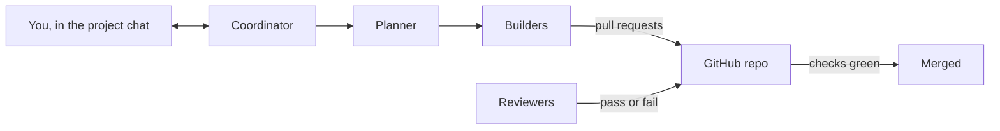

<!-- @doc
id = "GETTING-STARTED"
title = "Getting started"
kind = "guide"
status = "active"
review_every = "90d"
-->

# Getting started

> A plain-language guide for the person who owns a project made from this template: what the
> template does, how to start a new project with it, and what your job is once it runs.

You don't need to know git or automated development to use this. You describe what you want
built, answer a few questions, and approve the decisions only you can make. A team of AI
agents does the building, and checks on GitHub hold every change until it passes the tests
and a reviewer agent's verdict ([what keeps it safe](#safety)).

<a id="idea"></a>
## The idea in one minute
<!-- @section
-->

- **You are the maintainer.** You own the project and make the big calls: what the product is,
  the licence, what it may cost, anything public.
- **Claude runs as a team of agents** in a Claude project. Each agent has one job:
  - the **coordinator** talks to you and keeps everything moving;
  - **intake** asks you about the product on day one;
  - the **planner** splits the plan into small pieces;
  - several **builders** each build one piece;
  - two **reviewers** check every change;
  - **ops** keeps merges in order when changes would collide, puts `main` right when it
    breaks, and handles new issues and dependency updates;
  - the **board** keeps a progress page up to date;
  - a **device session** runs checks on your own computer, only when you allow it.
- **The code lives in a GitHub repository** (a "repo"): a shared folder with full history.
  Agents never change it directly. Each change is proposed as a **pull request** (a "PR"),
  checked automatically, reviewed by a reviewer agent, and only then merged.
- **Agents act under your GitHub login.** The PRs, comments and labels they make show your
  name ([Things you'll do on GitHub](#github)).
- **Bootstrap sets up GitHub for you.** A new repo starts with GitHub's default settings,
  which protect nothing. `scripts/bootstrap.sh` is a script you run once, or have Claude run
  on your computer for you. It switches on everything the template relies on: the rules that
  hold a merge until the checks pass, the required checks, labels, security alerts and secret scanning
  ([what it sets](#setup)). The few GitHub tasks left to you are in
  [Things you'll do on GitHub](#github).
- **You talk to one agent, the coordinator,** in the project chat. It asks you questions as
  cards you can answer with one tap, and posts a short summary once a day.



<a id="words"></a>
## Words you'll see
<!-- @section
-->

| Word | Meaning |
|---|---|
| repo | the project's folder on GitHub, with every past version kept |
| branch | a working copy inside the repo; `main` is the real one |
| commit | one saved change, with a message saying what it does |
| pull request (PR) | a proposal to merge a branch's changes into `main`, with checks and review |
| merge | accept a PR, so its changes become part of `main` |
| CI | the automatic checks GitHub runs on every PR (tests, formatting, docs) |
| check | one of those automatic tests; green passes, red fails |
| review gate | the check that only turns green when a reviewer agent passes the PR |
| bootstrap | the one-time setup script, `scripts/bootstrap.sh`, that switches on the repo's GitHub settings for you |
| ruleset | a GitHub rule on a branch, such as "every change to `main` needs a PR with green checks"; bootstrap creates them |
| ADR | a short record of a decision and why it stands ("architecture decision record") |
| label | a tag on a PR; some labels, like `governance-approved`, unlock a check |
| session | one running Claude agent, with its own conversation |
| session id | the name GitHub and the agents use for one session, like `session_01AbCdEfGhIjKlMnOpQrStUv` |
| thread | where one session works in the Claude project; you read the project chat, not the threads |
| card | a question from the coordinator in the chat, with options to tap and one marked as recommended |
| coordinator | the agent you talk to in the project chat |
| intake | the agent that asks you about the product on day one, then stops |
| wave | a batch of changes collected on a `wave/…` branch and merged together, when changes would collide |
| Dependabot | GitHub's own bot that proposes updates to the libraries the project uses |
| terminal | the text window where you type commands: Terminal on macOS, the Ubuntu app on Windows |
| `gh` | GitHub's command-line tool, used in a terminal; bootstrap uses it to change the settings |

<a id="before"></a>
## What you need
<!-- @section
-->

1. **A GitHub account.**
   - **A public repo is free, and everything works.**
   - **A private repo needs two paid features.** Rulesets, which protect `main`, need a paid
     plan: GitHub Pro for a personal account, or GitHub Team for an organization. The
     required `dependency-review` check needs GitHub Code Security. Bootstrap checks both
     and stops before changing anything if either is missing.
2. **GitHub Actions minutes.** The checks run on GitHub Actions. On a **public** repo they
   are free. On a **private** repo they come out of a monthly allowance of minutes that
   depends on your plan, and past it they are billed
   ([GitHub's billing page](https://docs.github.com/en/billing/managing-billing-for-github-actions/about-billing-for-github-actions)).
   A busy swarm runs CI on every push, about 15 to 30 runner-minutes each, so a private
   repo with many builders can use a month's allowance in a few days. Check your usage in
   your GitHub account's **Settings › Billing**, and set a spending limit there.
3. **A Claude plan that includes Projects.** The cost grows with the number of agents
   running at once. At the start you agree a **daily budget** with intake: a cap on how much
   agent work runs each day. At 80% of it nothing new starts, and at 100% the builders pause
   until you say to continue.
4. **On your computer: `git`, `gh` and Python 3.11 or later.** Bootstrap needs all three,
   whether you run it yourself or Claude runs it on your computer for you.
   - **macOS:** install [Homebrew](https://brew.sh/), then run `brew install git gh python`
     in Terminal. The `python3` that comes with macOS is often too old.
   - **Windows:** use WSL, which runs Linux inside Windows
     ([how to install it](https://learn.microsoft.com/en-us/windows/wsl/install)). In the
     Ubuntu app, install `git` and `python3` with `sudo apt install git python3`, and `gh`
     by [GitHub's instructions](https://cli.github.com/).
   - **Linux:** install `git`, `python3` (3.11 or later) and [`gh`](https://cli.github.com/)
     with your package manager.
5. **To have Claude run bootstrap for you:** the Claude desktop app on that computer.

> [!IMPORTANT]
> On a private repo without both paid features, either nothing protects `main` or no PR can
> merge. Make the repo public, or add them to your plan, before you run bootstrap.

<a id="start"></a>
## Starting a new project
<!-- @section
depends_on = ["AGENTS#day-0-order", "RUNBOOK-BOOTSTRAP#by-hand"]
-->

1. **Make your repo from the template.** Open the template, jeffmhopkins/template<!--fact:template-source-->
   ([open it on GitHub](https://github.com/jeffmhopkins/template)), and click **Use this
   template**, then **Create a new repository**. Leave **Include all branches**
   unchecked. Give it a name, and choose public or private
   ([what you need](#before)). This copies everything into a new repo that is yours.
2. **Install the Claude GitHub App** on the new repo from the
   [Claude app page](https://github.com/apps/claude). It lets the agents open PRs and
   comment. Do this before the next step, so the Claude project can see the repo.
3. **Create a Claude project** for it, and add the new repo to the project in its settings.
4. **Paste the project instructions.** Open
   [docs/agents/project-instructions.md](agents/project-instructions.md) on GitHub. Copy the
   grey block with the copy button at its top right, and paste it into the Claude project's
   instructions. In what you pasted, replace `PROJECT_NAME` with your project's name and
   `OWNER/REPO` with your repo, for example `jane/photo-sorter`.
5. **Run the one-time setup** (`scripts/bootstrap.sh`, called "bootstrap"). A new repo starts
   with GitHub's defaults, which let anyone with access merge anything. Bootstrap changes
   those settings to the ones the template relies on, so you don't have to click through
   GitHub's settings pages yourself. [What the setup does for you](#setup) lists every
   change. Either:
   - **ask Claude to do it:** in the project chat, say "Run the bootstrap on my computer".
     You'll be asked to allow Claude to work in a folder on your machine, which needs the
     Claude desktop app there ([what you need](#before)). If `gh` isn't signed in to GitHub
     on that computer yet, it asks you to run `gh auth login` once in a terminal there; or
   - **run it yourself** in a terminal. This example uses the repo `jane/photo-sorter`;
     replace it with yours:
     ```sh
     gh auth login
     gh repo clone jane/photo-sorter
     cd photo-sorter
     scripts/bootstrap.sh
     scripts/bootstrap.sh --check
     ```
     The last line should end with `All settings match.`
6. **Say hello.** In the project chat, write one or two sentences about what you want built,
   for example "A desktop app that sorts my photos by who's in them". The coordinator records
   who you are from this first message, so it can check every approval against you, then
   starts intake and the first reviewer. Bootstrap already told the review gate which
   reviewers to trust, so there is nothing to set when reviewers start or are replaced.
7. **After intake's first PR merges,** the coordinator asks you to paste the project
   instructions again, because intake added your answers to them, and to run bootstrap
   again, because intake may have changed the required checks.

<a id="setup"></a>
## What the setup does for you
<!-- @section
depends_on = ["RUNBOOK-BOOTSTRAP#settings", "RUNBOOK-BOOTSTRAP#by-hand"]
-->

Bootstrap changes your repo's GitHub settings in one run. You never need to find or change
any of these by hand:

| Setting | What bootstrap sets | What it means for you |
|---|---|---|
| How PRs merge | each PR lands as one tidy commit, titled from the PR; merge commits are allowed only into batch (`wave/…`) branches; branches are deleted after merging; auto-merge is on | `main` reads as a list of finished changes, and agents don't have to wait for anyone to press Merge |
| Rules on `main` | no deleting it, no rewriting its history, every change through a PR, and every required check green first | nothing reaches `main` without passing the tests and the reviewer |
| Rules on `wave/*` | the same rules for batch branches, except that GitHub deletes one once it has landed in `main` | the same protection when work is batched, and nothing slips into a batch after it lands |
| GitHub Actions | the automation can read but not change the repo or approve PRs; every action used must be pinned to an exact version; outside contributors' PRs wait for approval before running | the automation can't be hijacked into changing your code |
| Labels | `governance-approved`, `review-override`, `needs-human`, `hardware` | the labels the agents and checks use |
| Repo variables | `MAINTAINER_LOGIN` and `REVIEWER_LOGIN`, both your GitHub login, and `REVIEWER_ROLES`, the reviewer names `reviewer-0,reviewer-1,reviewer-2` | the checks know who you are and whose review comments to trust; you never change these when reviewers come and go |
| Security | Dependabot alerts and fixes, private vulnerability reporting (public repos), secret scanning, and blocking pushes that contain a password or key | you hear about vulnerable dependencies, people can report a security problem privately, and secrets can't be committed by accident |

Run it again at any time: it only changes what differs, and `scripts/bootstrap.sh --check`
shows what would change without changing anything. The full list, with the exact values, is
in the [bootstrap runbook](runbooks/bootstrap.md#settings).

**What bootstrap can't do**, because it needs your own accounts, is in the
[bootstrap runbook](runbooks/bootstrap.md#by-hand) and in steps 2, 3, 4 and 7 above. On a
**private** repo, you also turn on the dependency graph ([Things you'll do on GitHub](#github)).

<a id="github"></a>
## Things you'll do on GitHub
<!-- @section
depends_on = ["ADR-0002", "REVIEW#tiers", "AGENT-COORDINATOR#stop", "AGENT-COORDINATOR#daily-digest", "AGENT-COORDINATOR#marker-audit"]
-->

Bootstrap does almost all the setup. These few things need you, on GitHub's website.

**Your name on agent work.** The agents use your GitHub login, so their PRs, comments and
labels show your name. GitHub doesn't notify you about your own actions, so you won't get an
email for each one. To keep the rest quiet:
- on the repo's page, set **Watch** to **Participating and @mentions**;
- in your [notification settings](https://github.com/settings/notifications), under
  **Actions**, choose to be notified only about failed workflows. The coordinator tells you
  about anything that needs you.

**Decide in the project chat.** Give every decision by tapping the card's option or by
saying it in the project chat, never in a GitHub comment. A chat message has an id the agents
can check against you; a comment under your login could have come from an agent.

**Apply a label when a "ready to land" card asks.** Two labels are yours alone:
`review-override`, on any PR, and `governance-approved` on a PR that changes a file only you
may approve (the list is in [project-instructions.md](agents/project-instructions.md)). The
agents use your login, so GitHub can't tell who ticked a label: only you tick these. The
card comes only once the PR is otherwise ready to land: its other checks are green (the
`governance` check waits for your label), and the reviewer has passed it (or, for an
override, you have decided to override it). It says which PR and which label. Open the PR,
click **Labels** in the right-hand column, and tick the label. Then tap **Applied**. A push to the PR removes both labels. If the PR changes
again, a new card comes for the new version: tick the label again then.

**Private repo only.** Turn on the dependency graph in **Settings › Code security**, or the
`dependency-review` check fails. Public repos have it on already.

**After intake's first PR merges.** Paste the project instructions into the Claude project
again, and run bootstrap again, the same way as the first time.

**When the instructions change again.** A later PR may change
[project-instructions.md](agents/project-instructions.md). Once it merges, the coordinator
asks you with a card to paste the instructions again. Do it the same way as the first time,
then tap **Done**. Until you do, the agents run on the old instructions.

**Account keys.** When the product needs an account or a key, such as for a paid service,
the coordinator asks you for it. Create the account yourself. Put its key in the repo's
**Settings › Secrets and variables › Actions**, with **New repository secret**, under the
name the coordinator gives. The agents can't add or read secrets there, and never paste a
key into the project chat, a PR or an issue.

**Publishing a release.** A release is yours to publish. When a version is ready, the
coordinator asks you with a card. On your answer, an agent pushes the version's tag and
writes the release notes. Then, on the repo's page, open **Releases**, click **Draft a new
release**, choose that tag, paste the notes, and click **Publish release**. The agents can't
publish a release themselves.

**Template upgrades.** The template gets new versions. When you ask the coordinator to
upgrade, or it reports a new version and you agree, an agent brings the new version over in
one PR. That PR changes files only you may approve, so it asks you three things in turn:
- an approval card for the files it changes;
- a "ready to land" card to tick `governance-approved`;
- when the required checks change, bootstrap runs twice: once before the PR merges and once
  right after. The coordinator offers to run both on your computer.

If the upgrade changes the project instructions, paste them again once it merges.

<a id="intake"></a>
## The first conversation
<!-- @section
depends_on = ["AGENT-INTAKE#the-rounds"]
-->

An intake agent turns your idea into a plan in three short rounds, through the coordinator:

1. **The product.** It writes its best guess of what you want (who it's for, what it must
   never do, the first two things to demo) and you correct it in plain words.
2. **Your decisions.** A set of cards, each with a recommendation: licence, privacy, accounts
   and paid services, the daily budget, how it ships. Tap an option, or answer in words.
3. **Confirm.** One message restating everything, and one card to accept it.

It then opens the first PR with the product description, the roadmap and your decisions.
Once that merges, the coordinator asks you to paste the instructions and run bootstrap again
([step 7](#start)), then the planner splits the roadmap into small pieces and the builders
start.

<a id="day-to-day"></a>
## Day to day
<!-- @section
-->

- **Read the project chat, not the threads.** The coordinator posts milestones, questions and
  a daily digest: what merged, what's waiting, what needs you, and the cost so far.
- **Answer the cards.** Each names exactly what it asks about and marks a recommendation. If
  you don't mind, pick the recommendation.
- **Look at the pinned issues** on the repo's **Issues** tab now and then:
  - **Progress**: each milestone and how many of its items are done;
  - **Weekly sweep**: what needs a look this week. Read its list of PRs merged with
    `governance-approved` or `review-override`: each one loosened a check or skipped the
    reviewer, and its PR says why. The coordinator's digest asks whether to revert any;
  - **main is red**: only while `main` is broken; the agents are fixing it.
- **Outside pull requests** are closed by the agents, with a link to
  [CONTRIBUTING.md](../CONTRIBUTING.md), while contributions are closed. Issues from anyone
  are welcome and handled as usual.
- **Some things always wait for you:** changes to the review gate or the rules about who
  decides what, publishing anything, creating accounts, and spending beyond the budget. The
  full list is in [project-instructions.md](agents/project-instructions.md).
- **"Stop" stops everything** until you say "resume", merges included. The daily budget
  pauses new work at 80% and pauses the builders at 100% until you say to continue, or until
  the next budget day starts.
- **Hardware tests.** If the product needs testing on your own machine, the coordinator asks
  once a day whether now is a good time, and an agent runs the checks there with your
  permission.

> [!TIP]
> You never need to merge, review code or use git. Your only GitHub tasks are in
> [Things you'll do on GitHub](#github). If you want to look, each PR on GitHub shows what
> changed and what the reviewer said.

<a id="safety"></a>
## What keeps it safe
<!-- @section
depends_on = ["ADR-0002", "REVIEW#tiers", "AGENT-COORDINATOR#stop", "AGENT-COORDINATOR#daily-digest", "AGENT-COORDINATOR#marker-audit"]
-->

Some protections are enforced by GitHub. Others hold only because the agents follow their
rules, and are checked after the fact. This section says which is which.

**Enforced by GitHub.**
- **Every merge passes the required checks.** GitHub refuses a merge until each one is
  green: the tests, the docs check, the governance check and the review gate. The gate turns
  green only on a passing verdict marker for the exact version being merged.
- **The governance check and the review gate judge a PR with code it can't change.** They
  run from the branch the PR merges into, never from the PR itself.
- **The docs stay true.** Each doc section is linked to the code it describes. When the code
  changes, the docs check fails until an agent re-reads the section.

**Relies on the agents following their rules.**
- **The agents use your GitHub login.** GitHub can't tell their comments and labels from
  yours. "Only you apply this label" is a rule the agents follow, not something GitHub
  checks.
- **The review gate trusts that login too.** A builder could post a verdict marker the gate
  counts. Reviewers record every marker they post, and the coordinator checks each day that
  every marker behind a merge was one of theirs. It tells you about any that wasn't, after
  the merge.
- **A PR that edits a workflow can fake a check.** Its own edited workflow can post a
  passing result under any check's name, and GitHub can't tell it from the real one. Every
  workflow is a file only you may approve, so the real governance check fails and the
  reviewer escalates, but a faked result could still let the PR merge.
- **Governance changes land before anyone looks.** A change that loosens a check needs a
  label and a written reason. On most files the agent applies the label itself, so the PR
  can merge the same day. You see it afterwards, in the weekly sweep and the daily digest,
  and decide whether to revert it. Files only you may approve wait for you.
- **Your approval means your words.** An agent acts on a decision only when it cites your own
  chat message about that exact thing, and the reviewer reads that message itself. A card
  tap has no message of its own: the coordinator records who tapped it, and that record is
  what the reviewer checks ([agent security](SECURITY-AGENTS.md)).
- **"Stop" relies on the agents.** The coordinator disables the scheduled triggers, turns
  off auto-merge on every open PR so nothing merges, and tells every session to stop. A
  session that ignored it could still act.

**What closes the gaps later.** Giving builders, reviewers and the gate their own GitHub
identities ([ADR-0006](adr/0006-separate-agent-identities.md), proposed) makes your login
mean you, stops a builder from posting a verdict the gate counts, and posts the gate from an
identity no PR controls.

<a id="problems"></a>
## When something looks wrong
<!-- @section
-->

| You see | What it usually means |
|---|---|
| a red CI badge or a red check | a test or a setting failed; the agents fix their own PRs, and a "main is red" issue tracks it if `main` itself breaks |
| `review-gate`: "Gate not configured" | bootstrap hasn't set `REVIEWER_LOGIN` and `REVIEWER_ROLES` yet: run it again ([what it sets](#setup)) |
| a check stuck at "Expected", "Waiting for status to be reported" | the rules require a check that no workflow runs any more, usually because the required checks changed; run bootstrap again. For `review-gate` it can also mean no reviewer has looked yet |
| `dependency-review` fails with "not supported" | GitHub's dependency graph is off: turn it on in the repo's **Settings › Code security** |
| bootstrap stops with "is private, and its plan lacks" | the repo is private without the paid features the template needs ([what you need](#before)) |
| a PR labelled `needs-human` | a decision only you can make; the coordinator has a card for it |
| `review-gate`: "has no Claude-Session trailer", after you edited a file on a PR | don't commit to agent PRs yourself: a commit from GitHub's web editor has no `Claude-Session:` trailer and blocks the gate. Tell the coordinator what to change instead; the PR's agent drops your commit from its branch and makes the change itself |
| a label you ticked has gone | the PR got a new push, which removes `governance-approved` and `review-override`; tick it again when the next "ready to land" card asks |
| nothing happening for hours | a Claude usage limit: the agents' scheduled triggers keep firing, so work resumes on its own when it lifts. Or the daily budget reached 100%: the builders wait until you say "continue", or until the budget day resets. Or, on a private repo, the Actions minutes ran out: checks queue and never start; see **Settings › Billing** ([what you need](#before)) |

<a id="more"></a>
## Going further
<!-- @section
-->

- How the agents work together: [docs/agents/](agents/README.md).
- Every doc, by purpose: [docs/README.md](README.md).
- The full design of the template: [docs/design/template-design.md](design/template-design.md).
