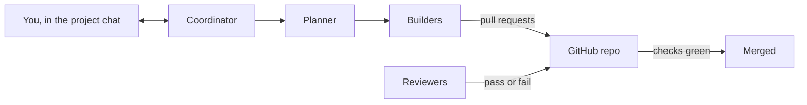

<!-- @doc
id = "GETTING-STARTED"
title = "Getting started"
kind = "guide"
status = "active"
review_every = "90d"
-->

# Getting started

> A plain-language guide for the person who owns a project made from this template: what the
> template does, how to start a new project with it, and what your job is once it runs.

You don't need to know git or automated development to use this. You describe what you want
built, answer a few questions, and approve the decisions only you can make. A team of AI
agents does the building, and checks on GitHub stop anything unreviewed from getting in.

<a id="idea"></a>
## The idea in one minute
<!-- @section
-->

- **You are the maintainer.** You own the project and make the big calls: what the product is,
  the licence, what it may cost, anything public.
- **Claude runs as a team of agents** in a Claude project. Each agent has one job: one asks
  you questions, one plans, several build, two review, and one keeps everything moving.
- **The code lives in a GitHub repository** (a "repo"): a shared folder with full history.
  Agents never change it directly. Each change is proposed as a **pull request** (a "PR"),
  checked automatically, reviewed by a reviewer agent, and only then merged.
- **You talk to one agent, the coordinator,** in the project chat. It asks you questions as
  cards you can answer with one tap, and posts a short summary once a day.



<a id="words"></a>
## Words you'll see
<!-- @section
-->

| Word | Meaning |
|---|---|
| repo | the project's folder on GitHub, with every past version kept |
| branch | a working copy inside the repo; `main` is the real one |
| commit | one saved change, with a message saying what it does |
| pull request (PR) | a proposal to merge a branch's changes into `main`, with checks and review |
| merge | accept a PR, so its changes become part of `main` |
| CI | the automatic checks GitHub runs on every PR (tests, formatting, docs) |
| check | one of those automatic tests; green passes, red fails |
| review gate | the check that only turns green when a reviewer agent passes the PR |
| ADR | a short record of a decision and why it stands ("architecture decision record") |
| label | a tag on a PR; some labels, like `governance-approved`, unlock a check |

<a id="before"></a>
## What you need
<!-- @section
-->

1. **A GitHub account.** Free is fine for a public repo. A private repo needs a paid plan for
   some of the protections.
2. **A Claude account with Projects**, and the Claude GitHub App installed on your repo
   (step 3 below).
3. **For the setup step, one of:**
   - the Claude desktop app on your computer, so an agent can run the setup there for you; or
   - the GitHub command-line tool `gh` and Python 3.11 or later, if you'd rather run it
     yourself.

<a id="start"></a>
## Starting a new project
<!-- @section
depends_on = ["AGENTS#day-0-order", "RUNBOOK-BOOTSTRAP#by-hand"]
-->

1. **Make your repo from the template.** On the template's GitHub page, click **Use this
   template**, then **Create a new repository**. Give it a name, and choose public or
   private. This copies everything into a new repo that is yours.
2. **Create a Claude project** for it, and add the new repo to the project in its settings.
3. **Install the Claude GitHub App** on the new repo from the [Claude app page](https://github.com/apps/claude). It lets
   the agents open PRs and comment.
4. **Run the one-time setup** (`scripts/bootstrap.sh`, called "bootstrap"). A new repo starts
   with GitHub's defaults, which let anyone with access merge anything. Bootstrap changes
   those settings to the ones the template relies on, so you don't have to click through
   GitHub's settings pages yourself. [What the setup does for you](#setup) lists every
   change. Either:
   - **ask Claude to do it:** in the project chat, say "Run the bootstrap on my computer".
     You'll be asked to allow Claude to work in a folder on your machine; or
   - **run it yourself** in a terminal:
     ```sh
     gh auth login
     gh repo clone <your-name>/<your-repo>
     cd <your-repo>
     scripts/bootstrap.sh
     scripts/bootstrap.sh --check
     ```
     The last line should end with `All settings match.`
5. **Paste the project instructions.** Open
   [docs/agents/project-instructions.md](agents/project-instructions.md), copy everything from
   the line that starts with `<PROJECT>` to the end, and paste it into the Claude project's
   instructions. Replace `<PROJECT>` with your project's name and `<owner>/<repo>` with your
   repo (for example `jane/photo-sorter`).
6. **Say hello.** In the project chat, write one or two sentences about what you want built,
   for example "A desktop app that sorts my photos by who's in them". The coordinator takes it
   from there.
7. **Turn on the review gate.** Once the coordinator says the reviewers are running, it gives
   you their session ids. Set them as the repo variable `REVIEWER_SESSIONS` (comma-separated),
   in **Settings › Secrets and variables › Actions › Variables**, or with
   `gh variable set REVIEWER_SESSIONS --body "<ids>"`. Until then no PR can merge.

<a id="setup"></a>
## What the setup does for you
<!-- @section
depends_on = ["RUNBOOK-BOOTSTRAP#settings", "RUNBOOK-BOOTSTRAP#by-hand"]
-->

Bootstrap changes your repo's GitHub settings in one run. You never need to find or change
any of these by hand:

| Setting | What bootstrap sets | What it means for you |
|---|---|---|
| How PRs merge | each PR lands as one tidy commit, titled from the PR; branches are deleted after merging; auto-merge is on | `main` reads as a list of finished changes, and agents don't have to wait for anyone to press Merge |
| Rules on `main` | no deleting it, no rewriting its history, every change through a PR, and every required check green first | nothing reaches `main` without passing the tests and the reviewer |
| Rules on `wave/*` | the same rules for batch branches | the same protection when work is batched |
| GitHub Actions | the automation can read but not change the repo or approve PRs; every action used must be pinned to an exact version; outside contributors' PRs wait for approval before running | the automation can't be hijacked into changing your code |
| Labels | `governance-approved`, `review-override`, `needs-human`, `hardware` | the labels the agents and checks use |
| Repo variables | `REVIEWER_LOGIN` (your GitHub login) and an empty reviewer list | the review gate knows whose comments to trust |
| Security | Dependabot alerts and fixes, secret scanning, and blocking pushes that contain a password or key | you hear about vulnerable dependencies, and secrets can't be committed by accident |

Run it again at any time: it only changes what differs, and `scripts/bootstrap.sh --check`
shows what would change without changing anything. The full list, with the exact values, is
in the [bootstrap runbook](runbooks/bootstrap.md#settings).

**What bootstrap can't do**, because it needs your own accounts:
- install the Claude GitHub App (step 3);
- paste the project instructions into the Claude project (step 5);
- fill in the reviewer list once the reviewers start (step 7);
- on a **private** repo, turn on the dependency graph in **Settings › Code security**, or the
  `dependency-review` check fails. Public repos have it on already.

<a id="intake"></a>
## The first conversation
<!-- @section
depends_on = ["AGENT-INTAKE#the-rounds"]
-->

An intake agent turns your idea into a plan in three short rounds, through the coordinator:

1. **The product.** It writes its best guess of what you want (who it's for, what it must
   never do, the first two things to demo) and you correct it in plain words.
2. **Your decisions.** A set of cards, each with a recommendation: licence, privacy, accounts
   and paid services, the daily budget, how it ships. Tap an option, or answer in words.
3. **Confirm.** One message restating everything, and one card to accept it.

It then opens the first PR with the product description, the roadmap and your decisions. Once
that merges, the planner splits the roadmap into small pieces and the builders start.

<a id="day-to-day"></a>
## Day to day
<!-- @section
-->

- **Read the project chat, not the threads.** The coordinator posts milestones, questions and
  a daily digest: what merged, what's waiting, what needs you, and the cost so far.
- **Answer the cards.** Each names exactly what it asks about and marks a recommendation. If
  you don't mind, pick the recommendation.
- **Some things always wait for you:** changes to the review gate or the rules about who
  decides what, publishing anything, creating accounts, and spending beyond the budget. The
  full list is in [project-instructions.md](agents/project-instructions.md).
- **"Stop" stops everything** until you say "resume". The daily budget pauses new work at 80%
  and pauses the builders at 100% until you say to continue.
- **Hardware tests.** If the product needs testing on your own machine, the coordinator asks
  once a day whether now is a good time, and an agent runs the checks there with your
  permission.

> [!TIP]
> You never need to merge, review code or touch git. If you want to look, each PR on GitHub
> shows what changed and what the reviewer said.

<a id="safety"></a>
## What keeps it safe
<!-- @section
-->

- **Nothing reaches `main` unreviewed.** GitHub refuses a merge until every required check is
  green, and one of them is the reviewer's verdict on the exact version being merged.
- **Agents can't weaken the checks quietly.** Any change to the checks, the rules or the
  settings is flagged, needs a written reason, and appears in a weekly report.
- **Your approval means your words.** An agent can act on a decision only when it quotes your
  own message about that exact thing. A summary or a guess doesn't count
  ([agent security](SECURITY-AGENTS.md)).
- **The docs stay true.** Each doc section is linked to the code it describes. When the code
  changes, the doc must be re-read before the change can merge.

<a id="problems"></a>
## When something looks wrong
<!-- @section
-->

| You see | What it usually means |
|---|---|
| a red CI badge or a red check | a test or a setting failed; the agents fix their own PRs, and a "main is red" issue tracks it if `main` itself breaks |
| `review-gate`: "Gate not configured" | the reviewer list is still empty; set it once the reviewers are running ([bootstrap runbook, by hand](runbooks/bootstrap.md#by-hand)) |
| `dependency-review` fails with "not supported" | GitHub's dependency graph is off: turn it on in the repo's **Settings › Code security** |
| a PR labelled `needs-human` | a decision only you can make; the coordinator has a card for it |
| nothing happening for hours | a usage limit or the budget pause; the coordinator resumes on its own when the limit lifts |

<a id="more"></a>
## Going further
<!-- @section
-->

- How the agents work together: [docs/agents/](agents/README.md).
- Every doc, by purpose: [docs/README.md](README.md).
- The full design of the template: [docs/design/template-design.md](design/template-design.md).
