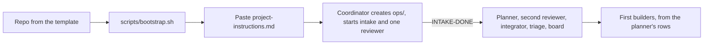
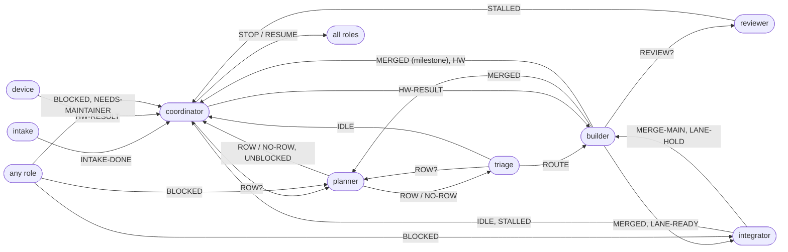

<!-- @doc
id = "AGENTS"
title = "Agent types"
kind = "brief"
status = "active"
review_every = "90d"
-->

# Agent types

> Which agents run and how many, the order they start in on day 0, the one-line messages
> they send each other, and the shared state each one owns.

There is one brief per agent type. They live at `docs/agents/`. A session starts with its brief's path. Briefs don't
restate repo rules: they point to CLAUDE.md, REVIEW.md and the runbooks. Standing permissions
and the approval contract live only in [project-instructions.md](project-instructions.md).

| Type | File | Count | Runs as |
|---|---|---|---|
| Intake | [intake.md](intake.md) | 1, first | a thread that questions the maintainer about the product, then ends |
| Coordinator | [coordinator.md](coordinator.md) | 1 | the project's chat session |
| Planner | [planner.md](planner.md) | 1 | a standing thread |
| Builder | [builder.md](builder.md) | at most 6 per reviewer (12 to start) | one thread per roadmap row, ended after its PR merges |
| Reviewer | [reviewer.md](reviewer.md) | 2 to start, 3 at about 18 ready PRs | standing threads, one per shard |
| Reviewer worker | [reviewer-worker.md](reviewer-worker.md) | at most 2 per reviewer at a time | an Agent-tool worker a reviewer starts for one PR |
| Integrator | [integrator.md](integrator.md) | 1 | a standing thread |
| Triage | [triage.md](triage.md) | 1 | a standing thread |
| Board | [board.md](board.md) | 1 small thread, or a scheduled task | a cheap-model thread that rebuilds an artifact hourly |
| Device session | [device.md](device.md) | 0 or 1 | Remote Control on the maintainer's machine |

## Day 0 order
<!-- @section
-->

1. The maintainer creates the repo from the template and runs `scripts/bootstrap.sh`
   (or asks for it on their machine through a device session). Bootstrap uses template
   defaults.
2. The maintainer pastes [project-instructions.md](project-instructions.md) into the project
   settings, filling in the project name.
3. The coordinator creates `ops/` (below), then starts intake and one reviewer together, so
   intake's design PR can be reviewed.
4. On `INTAKE-DONE`, the coordinator starts the planner, the second reviewer, the integrator,
   triage and the board, then launches the first builders from the planner's rows.

## Messages
<!-- @section
-->

Agents send each other one-line messages with `send_message`, in these fixed formats.
**Role-to-role lines go direct**, addressed through `ops/roster.md`. The coordinator gets only
the lines marked ★. Forward a
line verbatim; never rewrite it.

<b>All message formats</b> (16)

| Line | From → to | Receiver does |
|---|---|---|
| `ROW? <ask>` | coordinator, triage → planner | writes a row |
| `ROW <id> (brief: ops/launch.md#<id>)` / `NO-ROW <ask>: <why>` | planner → asker | ★ coordinator launches it, or reports why not |
| `UNBLOCKED <ids>` | planner → coordinator ★ | launches rows not already in `roster.md` |
| `IDLE <thread>: can take <row>` | triage, integrator → coordinator ★ | hands the row to that thread |
| `REVIEW? #<pr> <sha>` | builder → its shard's reviewer | reviews that head now |
| `MERGED <item> #<pr> [wave/<name>]` | builder → planner and integrator; ★ coordinator for milestone items | planner: unblock; integrator: lanes |
| `MERGE-MAIN #<pr>: <what conflicts>` | integrator → builder | merges main or the wave next |
| `LANE-READY <lane> #<pr>` / `LANE-HOLD <lane> <value> #<pr>` | builder ↔ integrator | asks for / grants the lane slot |
| `ROUTE #<issue> → <row>` | triage → that row's builder | fixes it in the PR, or answers `BLOCKED` |
| `BLOCKED <item>: <what>, needs <who>` | any → planner (paths), integrator (merges), ★ coordinator (maintainer) | unblocks or reroutes |
| `STALLED #<pr>` | reviewer, integrator → coordinator ★ | nudges once, then adopts the PR |
| `NEEDS-MAINTAINER <item or #pr>: <question> (rec: <option>)` | any → coordinator ★ | one decision card per object, de-duplicated |
| `HW <item> #<pr>: ops/hw/<item>.md` | builder → coordinator ★ | adds it to the device queue |
| `HW-RESULT <item> #<pr>: pass/fail/not-run <issue>` | device → coordinator ★ → builder | builder fixes, or closes the tracking issue |
| `INTAKE-DONE #<pr>` | intake → coordinator ★ | starts the other roles |
| `STOP` / `RESUME` | coordinator → all | stop at once / pick up from state files |

## State: `/mnt/project-files/ops/`
<!-- @section
-->

The shared folder is a network mount where the last write wins, so:
1. **One writer per file.** The owner's role is the file's first line. Others read it, and
   message the owner to change it.
2. **Several producers means one file per event** (`decisions/<message-id>.md`), never a
   shared file edited by many.
3. **Write a temp file, then rename.** Readers ignore `*.tmp`.
4. **GitHub is the source of truth where it can be.** Review state, lanes and progress can be
   rebuilt from PRs, markers and `main`. A file is a cache; on a cold start, rebuild it.
5. **Sub-workers never write `ops/`.** They return results; the session that started them
   writes.

| File | Owner | Holds |
|---|---|---|
| `STOP` | coordinator | present = stopped. Every routine and session checks it first and exits |
| `mode.md` | integrator | waves on or off, the current wave, main's health |
| `roster.md` | coordinator | role or row → session id, PR, state, who is subscribed to the PR |
| `coordinator.md` | coordinator | open cards (by object id), pending relays, the launch count |
| `decisions/<message-id>.md` | coordinator | one file per maintainer decision, with its link |
| `pending.md` | coordinator | open maintainer questions, the hardware queue, accounts to create |
| `launch.md` | planner | one anchored section per row (format in planner.md). Whether a row is launched is in `roster.md` |
| `roadmap.md` | planner | lanes, hot spots, the maintainer-only list |
| `review/state-<shard>.md` | that reviewer | stable session id, then `PR | shard | head | round | verdict` |
| `lanes.md` | integrator | per lane: holder, then ready PRs in order |
| `waves.md` | integrator | open waves, what each carries, cut and landing plan |
| `triage.md` | triage | last sweep, routed issues, flake links |
| `hw/<item>.md` | the item's builder | the hardware checklist |

## Lifecycle rules every brief assumes
<!-- @section
-->

- **On every wake, first** check `ops/STOP` (stop if present) and `ops/mode.md`.
- **A PR's events go to its author session only.** Builders subscribe to their PRs, the
  integrator to the wave PRs it opens, triage to Dependabot PRs. Other roles poll.
- **Adoption.** When a session dies or is replaced, the coordinator starts a new one with
  "adopt #<pr>". The new session subscribes, reads the PR and the old thread, and the
  coordinator archives the old one and updates the roster.
- **No status posts in threads.** Every reply in a thread wakes the coordinator. Reply in a
  thread only when the maintainer wrote there.
- **Builders end after their PR merges.** A fresh row gets a fresh thread, except a stacked
  follow-up in the same lane.
