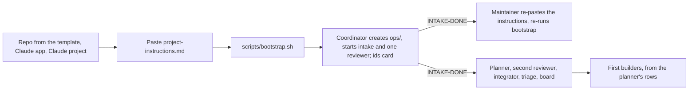
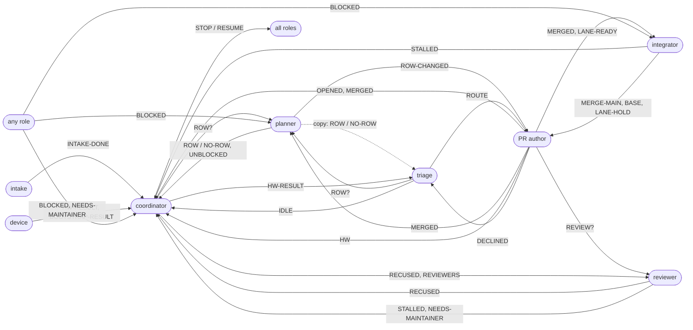

<!-- @doc
id = "AGENTS"
title = "Agent types"
kind = "brief"
status = "active"
review_every = "90d"
-->

# Agent types

> Which agents run and how many, the order they start in on day 0, the one-line messages
> they send each other, and the shared state each one owns.

There is one brief per agent type. They live at `docs/agents/`. A session starts with its brief's path. Briefs don't
restate repo rules: they point to CLAUDE.md, REVIEW.md and the runbooks. Standing permissions
and the approval contract live only in [project-instructions.md](project-instructions.md).

| Type | File | Count | Runs as |
|---|---|---|---|
| Intake | [intake.md](intake.md) | 1, first | a thread that questions the maintainer about the product, then ends |
| Coordinator | [coordinator.md](coordinator.md) | 1 | the project's chat session |
| Planner | [planner.md](planner.md) | 1 | a standing thread |
| Builder | [builder.md](builder.md) | at most 6 per reviewer (12 to start) | one thread per roadmap row, ended after its PR merges |
| Reviewer | [reviewer.md](review/reviewer.md) | 2 to start, a 3rd when review stays the bottleneck ([coordinator › Reviewers](coordinator.md#reviewers)) | standing threads, one per shard |
| Reviewer worker | [reviewer-worker.md](review/reviewer-worker.md) | at most 2 per reviewer at a time | an Agent-tool worker a reviewer starts for one PR |
| Integrator | [integrator.md](integrator.md) | 1 | a standing thread |
| Triage | [triage.md](triage.md) | 1 | a standing thread |
| Board | [board.md](board.md) | 1 small thread, or a scheduled task | a cheap-model thread that rebuilds an artifact hourly |
| Device session | [device.md](device.md) | 0 or 1 | Remote Control on the maintainer's machine |

<a id="day-0-order"></a>
## Day 0 order
<!-- @section
-->

The maintainer's side of the same steps is in
[Getting started](../GETTING-STARTED.md#start).

1. The maintainer creates the repo from the template, installs the Claude GitHub App on it,
   and adds it to the Claude project.
2. The maintainer pastes the block in [project-instructions.md](project-instructions.md)
   into the project settings, filling in `PROJECT_NAME` and `OWNER/REPO`.
3. Bootstrap runs with template defaults: the maintainer runs `scripts/bootstrap.sh`, or asks
   in the chat and the coordinator starts a device session for it
   ([device › Bootstrap](device.md#bootstrap)).
4. The coordinator records the maintainer's user id in `ops/maintainer.md` from their first
   message, creates the other `ops/` files with their starting content (below), then starts
   intake and one reviewer together, so intake's design PR can be reviewed. It posts the
   reviewer's session id as a card for the maintainer to set as `REVIEWER_SESSIONS`.
5. On `INTAKE-DONE`, the coordinator asks the maintainer to paste the instructions again and
   re-run bootstrap, since intake may have changed both. It starts the planner, the second
   reviewer (with a new ids card), the integrator, triage and the board, then launches the
   first builders from the planner's rows.



<a id="messages"></a>
## Messages
<!-- @section
-->

Agents send each other one-line messages with `send_message`, in these fixed formats.
**Role-to-role lines go direct**, addressed through `ops/roster.md`. The coordinator gets only
the lines marked ★, and always gets `ROW`, `NO-ROW`, `OPENED` and `MERGED`, so the roster is
never stale. Forward a line verbatim; never rewrite it. A line not in this table is not sent.



"PR author" is whichever session opened the PR ([Lifecycle](#lifecycle)): a builder, intake,
the planner, the integrator or triage.

<details>
<summary><b>All message formats</b> (23)</summary>

| Line | From → to | Receiver does |
|---|---|---|
| `ROW? <ask>` | coordinator, triage → planner | writes a row |
| `ROW <id> (brief: ops/launch.md#<id>)` / `NO-ROW <ask>: <why>` | planner → coordinator ★, copied to the asker when that is triage | coordinator: launches the row, or reports why not; triage: notes the outcome against the issue |
| `UNBLOCKED <ids>` | planner → coordinator ★ | launches the rows not already in `roster.md` |
| `ROW-CHANGED <id>: <what changed>` | planner → that row's author | re-reads its section in `ops/launch.md` and stays inside the new `owns` |
| `IDLE <thread>: can take <row>` | triage → coordinator ★ | only for a stacked follow-up in the same lane as that thread's merged PR: hands it over |
| `OPENED <row or -> #<pr>` | PR author → coordinator ★ | writes the PR and its shard into `roster.md` |
| `REVIEW? #<pr> <sha>` | PR author → its shard's reviewer, from `roster.md` | reviews that head now |
| `RECUSED #<pr>` | reviewer → coordinator ★ → the next shard's reviewer | coordinator moves the PR to the next shard in `roster.md` and forwards the line; that reviewer reviews it |
| `REVIEWERS <shard>=<session id>,…` | coordinator → every reviewer and running PR author | after a reviewer starts or is replaced: re-read `roster.md` for shards |
| `MERGED <item or -> #<pr> [wave/<name>]` | PR author → coordinator ★, planner and integrator | coordinator: sets the row `merged`, archives the session; planner: unblocks; integrator: lanes and waves |
| `MERGE-MAIN #<pr>: <what conflicts>` | integrator → PR author | merges main, or its wave, next |
| `BASE #<pr> <branch>` | integrator → PR author | the PR now targets `<branch>`, or `<branch>` was synced or cut: merge it in now |
| `LANE-READY <lane> #<pr>` / `LANE-HOLD <lane> <value> #<pr>` | PR author ↔ integrator | asks for / grants the lane slot |
| `ROUTE #<issue> → <row>` | triage → that row's author | fixes it in the PR, or answers `DECLINED` |
| `DECLINED #<issue>: <why>` | PR author → triage | takes the issue back: fixes it, routes it elsewhere, or asks the planner `ROW?` |
| `BLOCKED <item or #pr>: <what>, needs <path <glob> \| #<pr> \| maintainer>` | any → planner (a path), integrator (a PR to merge first), coordinator ★ (the maintainer) | unblocks or reroutes |
| `STALLED #<pr>` | reviewer, integrator → coordinator ★ | only when the PR's author is silent: nudges once, then adopts the PR |
| `NEEDS-MAINTAINER <item or #pr>: <question> (rec: <option>)` | any → coordinator ★ | one decision card per object, de-duplicated |
| `HW <item> #<pr>: #<issue>` | PR author → coordinator ★ | adds it to the hardware queue in `ops/pending.md` |
| `HW-RESULT <item> #<pr>: pass/fail/not-run #<issue>` | device → coordinator ★ → triage, or the item's author while `roster.md` shows it running | pass: opens the record PR; fail: fixes it; not-run: the coordinator queues it again |
| `INTAKE-DONE #<pr>` | intake → coordinator ★ | asks the maintainer to re-paste the instructions and re-run bootstrap; starts the other roles |
| `BOOTSTRAP-RESULT ok/stopped/failed: <the script's last line or stop message>` | device → coordinator ★ | tells the maintainer the result in the chat, with the script's stop message when it stopped |
| `STOP` / `RESUME` | coordinator → all | stop at once / pick up from state files |

</details>

<a id="state"></a>
## State: `/mnt/project-files/ops/`
<!-- @section
depends_on = ["TOOL#plans"]
-->

> [!WARNING]
> The shared folder is a network mount where the last write wins, so:
> 1. **One writer per file.** The owner's role is the file's first line. Others read it, and
>    message the owner to change it. On day 0 the coordinator creates every file with its
>    starting content; from then on only the owner writes it.
> 2. **Several producers means one file per event** (`decisions/<message-id>.md`), never a
>    shared file edited by many.
> 3. **Write a temp file, then rename.** Readers ignore `*.tmp`.
> 4. **GitHub is the source of truth where it can be.** Review state, lanes and progress can be
>    rebuilt from PRs, markers and `main`. A file is a cache; on a cold start, rebuild it.
> 5. **Sub-workers never write `ops/`.** They return results; the session that started them
>    writes.

| File | Owner | Holds |
|---|---|---|
| `STOP` | coordinator | present = stopped. Every routine and session checks it first and exits |
| `maintainer.md` | coordinator | the maintainer's user id, which every approval is checked against |
| `mode.md` | integrator | waves on or off, the current wave, main's health |
| `roster.md` | coordinator | each role's session, and each row's session, PR, shard and state |
| `coordinator.md` | coordinator | open cards (by object), pending relays, launches and budget use today, paused routines |
| `decisions/<message-id>.md` | coordinator | one file per maintainer decision |
| `pending.md` | coordinator | open maintainer questions, the hardware queue, accounts to create |
| `launch.md` | planner | one anchored section per row ([planner › The row](planner.md#the-row)). Whether a row is launched is in `roster.md` |
| `roadmap.md` | planner | lanes, hot spots, what only the maintainer can do, what's left |
| `review/state-<shard>.md` | that reviewer | its session id and one line per round, with the comment id of its marker |
| `lanes.md` | integrator | per lane: holder, then ready PRs in order |
| `waves.md` | integrator | each wave, its state, what it carries, its landing PR |
| `triage.md` | triage | last sweep, routed issues, flakes, PRs whose auto-merge it turned off |
| `heads/<role>.txt` | that role | the `scripts/repo heads-changed` state for its sweep or reconcile |

**Formats.** Each file's first line is its owner's role. What follows, with the starting
content the coordinator writes on day 0:

- `maintainer.md`: `author_id: <user_…>`, then `source: <message id>`: the maintainer's first
  message in the project, whose author kind is `user`. It changes only on the maintainer's
  own words, with that message's id as the new `source:`.
- `mode.md`: three lines, starting as `waves: off`, `wave: none`, `main: green`. `waves` is
  `on` or `off`, `wave` the current `wave/<name>` or `none`, `main` is `green` or `red #<issue>`.
- `roster.md`: two tables. `scripts/repo plan check` reads the second one.

  ```markdown
  | role | session | state |
  |---|---|---|
  | reviewer-0 | session_01… | running |

  | row | session | pr | shard | state |
  |---|---|---|---|---|
  | B4 | session_01… | #12 | 0 | review |
  ```

  Roles are `intake`, `planner`, `reviewer-<shard>`, `integrator`, `triage`, `board` and
  `device`; a role's state is `running` or `ended`. A row is an item id from `launch.md`, or
  `#<pr>` for a PR with no row (a Dependabot PR, a wave PR, a progress PR). Its state is
  `building` (draft), `review` (ready), `waiting` (on a lane, a base PR, hardware or the
  maintainer), `merged` or `ended` (closed unmerged, or abandoned). `plan check` counts every
  row as running unless it is `merged` or `ended`. Both tables start empty, under their
  header lines.
- `coordinator.md`: `## Cards` (`<object> | <card message id> | open/answered`),
  `## Relays` (`<message id> → <session>`), then `launches today: 0`, `used today: 0`
  (the budget unit, [coordinator › Daily digest](coordinator.md#daily-digest)),
  `last marker audit: none` ([coordinator › Marker audit](coordinator.md#marker-audit)) and
  `paused routines: none`.
- `decisions/<message-id>.md`: `source: <message id>`, `author_id: <user_…>`,
  `object: <ADR id, #pr or path>`, `words: "<their words, quoted>"`, and
  `relayed to: <sessions>`. For a card tap, `source:` is the card's message id and `words:`
  the option label.
- `pending.md`: `## Questions`, `## Hardware queue` (`<item> #<pr> #<issue>`, in priority
  order) and `## Accounts`, each starting empty.
- `launch.md`: one section per row, as the planner brief says. Starts empty.
- `roadmap.md`: `## Lanes`, `## Hot spots`, `## Only the maintainer`, `## What's left`.
- `review/state-<shard>.md`: `session: <id>`, then
  `| pr | shard | head | round | verdict | comment | note |`, starting empty. `comment` is
  the id of the comment that carries the marker.
- `lanes.md`: one `## <lane>` per lane in `lanes.toml`, with `holder: #<pr>` or `none`, and
  `ready: #<pr>, …` in order.
- `waves.md`: one `## wave/<name>` per wave, with `state: open | cut | landing`,
  `carries: #<pr>, …`, `landing: #<pr>` or `none`, and `fixes: #<pr>, …`. Starts empty.
- `triage.md`: `last sweep: none`, then `## Routed` (`#<issue> → <row>`), `## Flakes`
  (`<test> | #<issue>`) and `## Auto-merge off` (`#<pr>`).

<a id="permissions"></a>
## Shell permissions
<!-- @section
covers = [".claude/settings.json"]
-->

[`.claude/settings.json`](../../.claude/settings.json) sets which shell commands a session
runs without asking, and which it never runs. It is a maintainer-only path. The lists are a
second line of defence: the rules in the briefs still apply to every allowed command.

**Allowed without a prompt:**
- the repo tool, the stack's format, lint, test, build and dependency commands, and
  `node --test`;
- `scripts/bootstrap.sh --check` only. Bootstrap's write mode changes repository settings,
  so it always prompts;
- reading and writing git history, pushing a branch, and worktrees;
- reading PRs, issues and runs, and the PR loop's writes: create, edit, comment, ready,
  `gh pr merge <n> --auto …` and `gh pr merge <n> --disable-auto`, issues, re-runs and the
  review gate's re-run;
- `gh api repos/…` reads.

**Denied, whatever the allow list says:**
- force pushes, pushes that delete a branch or update one with `+`;
- `gh pr merge --admin`;
- adding `review-override` with `gh pr edit` or `gh issue edit`. Only the maintainer applies
  it ([R-GOV-002](../RULES.md#R-GOV-002));
- `gh api` with a method or a body in any spelling: `-X`, `--method`, `-f`, `-F`, `--field`,
  `--raw-field` and `--input`, joined to their value or not. What's left is a GET;
- repository settings, variables, secrets, rulesets, label creation and deletion, and
  releases.

`governance-approved` on a maintainer-only path can't be told apart by a command pattern;
the rule in [project-instructions.md](project-instructions.md) covers it.

<a id="lifecycle"></a>
## Lifecycle rules every brief assumes
<!-- @section
-->

- **On every wake, first** check `ops/STOP` (stop if present) and `ops/mode.md`.
- **Whoever opens a PR is its author session**: a builder, intake, the planner, the
  integrator or triage, which is also the author of Dependabot's PRs. The author subscribes
  to the PR's events, sends `OPENED`, and drives it by
  [builder › The loop](builder.md#the-loop), steps 3 to 6 and 8, until it merges. Then it
  sends `MERGED`. A PR's events go to its author session only; other roles poll.
- **Adoption.** When a session dies or is replaced, the coordinator starts a new one with
  "adopt #<pr>". The new session subscribes, reads the PR and the old thread, and the
  coordinator archives the old one and updates the roster.
- **No status posts in threads.** Every reply in a thread wakes the coordinator. Reply in a
  thread only when the maintainer wrote there.
- **Builders end after their PR merges.** A fresh row gets a fresh thread, except a stacked
  follow-up in the same lane, which triage offers with `IDLE`.
- **Reconcile from `main`.** Events can be lost when a session dies. The planner and the
  integrator each run an hourly reconcile (`send_later` after each one): first
  `scripts/repo heads-changed --state /mnt/project-files/ops/heads/<role>.txt`, ending the
  turn on `unchanged`; otherwise read `main` and the merged PRs, and act on every merge as if
  its `MERGED` line had arrived.
