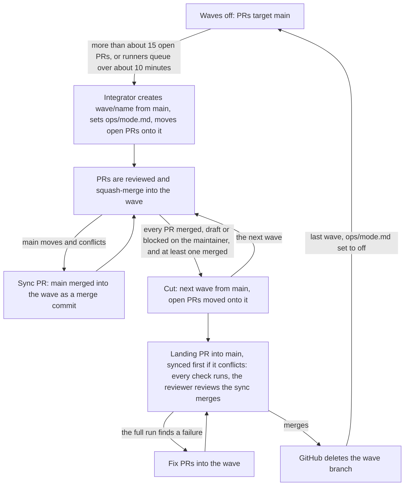

<!-- @doc
id = "RUNBOOK-WAVES"
title = "Wave branches runbook"
kind = "runbook"
status = "active"
review_every = "90d"
-->

# Wave branches runbook

> When the integrator turns waves on, which branch each PR targets, and how a wave is
> synced with `main`, cut and landed.

Who does what with wave branches, in what order. The decision is
[ADR-0005](../adr/0005-waves-and-serial-lanes.md). The integrator owns every wave
([integrator brief](../agents/integrator.md)). Whether waves are on, and which wave is
current, is in `ops/mode.md`.

## When waves are on
<!-- @section
depends_on = ["ADR-0005"]
-->

Waves are off by default. The integrator turns them on when more than about 15 PRs are
open, or runners queue for more than about 10 minutes:

1. Create `wave/<name>` from `main` with the GitHub MCP tool `create_branch`.
2. Set `ops/mode.md` to waves on, naming the current wave.
3. Move the open PRs onto it ([Which branch a PR targets](#which-wave)), and send each
   affected builder one line naming its new base.

The integrator turns them off by landing the last wave and setting `ops/mode.md` to waves
off. PRs then target `main` again.

## Which branch a PR targets
<!-- @section
depends_on = ["ADR-0005"]
-->

While waves are on:

| The PR | Targets |
|---|---|
| Delivers or advances a roadmap item | the current wave |
| A fix, docs or tests with no roadmap item | the current wave |
| Changes a serial lane | the current wave, unless the integrator says otherwise |
| Changes CI, the review gate, the repo tool, governance or the rules themselves | `main` |
| Opened by Dependabot | `main` |
| An urgent fix the maintainer asks to land now | `main` |

A stacked PR keeps the PR below it as its base; only the bottom of a stack targets a wave.

To move an open PR, change its base with the GitHub MCP tool `update_pull_request`, then
merge the new base in ([Keeping a PR current](#current)) and push. Changing the base alone
doesn't re-run CI. Never close and reopen a PR to move it.

## Keeping a PR current
<!-- @section
depends_on = ["DOCS#merge"]
-->

A PR into a wave merges its wave, not `main`:
`scripts/repo docs merge-main --from wave/<name>`. It resolves ledger and generated-block
conflicts and lists the sections to re-read and verify. Merge, never rebase.

Everything else in [CLAUDE.md](../../CLAUDE.md#pr-loop) holds: auto-merge (squash) on once
the PR leaves draft, every blocking finding answered, and the `Completes:` or `Part-of:`
line at the end of the body.

## Syncing main into the wave
<!-- @section
depends_on = ["DOCS#merge"]
-->

A `wave/*` branch only takes PRs. To bring `main` in, the integrator:

1. Branches off the wave and runs `scripts/repo docs merge-main`.
2. Re-reads and verifies the stale sections, each with its own note.
3. Opens a **sync PR** into the wave titled `chore(wave): merge main into wave/<name>`, and
   turns on auto-merge with `mergeMethod: MERGE`. A sync PR is never squashed.

It syncs whenever `main` moves in a way that conflicts with the wave, and before cutting.

## Cutting and landing a wave
<!-- @section
depends_on = ["ADR-0005", "REVIEW#gather"]
-->

Cut a wave when every PR still targeting it is merged, draft, or blocked on the maintainer,
and at least one PR has merged into it. Then:

1. Create the next wave from `main`, and move every open PR that targets the cut wave onto
   it, drafts included, messaging each moved PR's builder. Nothing merges into a wave after
   it is cut.
2. Sync the cut wave with `main` if it conflicts ([Syncing](#sync)).
3. Open the landing PR from the wave into `main`, titled `chore(wave): land wave/<name>`.
   Its body lists each carried PR with its number and title, then every carried
   `Completes:` and `Part-of:` line, and the "Governance change" section of every carried
   PR that had one. Apply `governance-approved` if any did. Turn on auto-merge (squash).
4. The reviewer reviews the sync merges and conflict resolutions
   ([REVIEW.md](../../REVIEW.md#gather)). Every check runs.
5. Fix what the full run finds with fix PRs into the wave. The builder that wrote the
   failing change helps if it is still running.
6. While the landing PR merges, other PRs in the wave may have auto-merge turned off (a
   freeze). Turn it back on once it lands.

GitHub deletes the wave branch when it merges.
